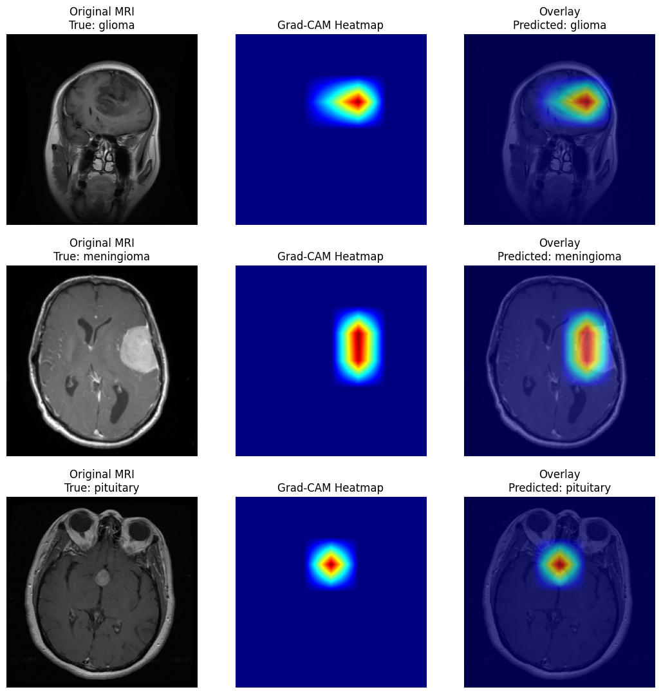
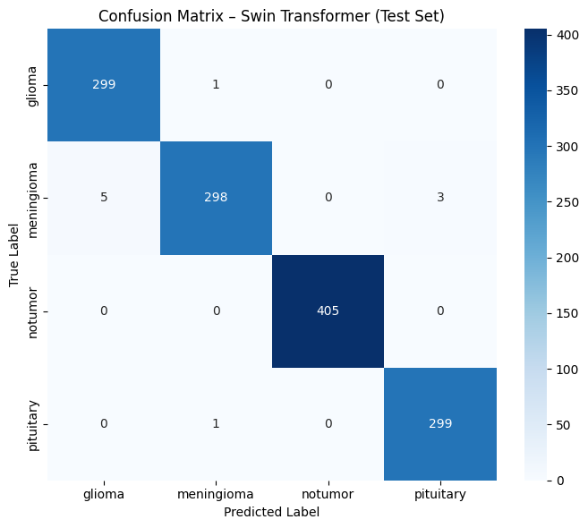
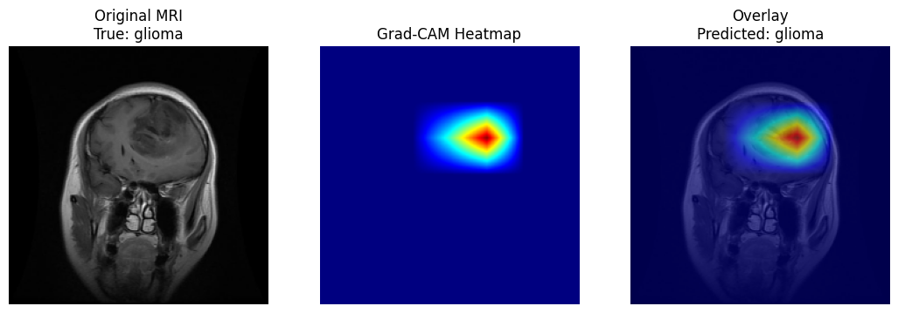
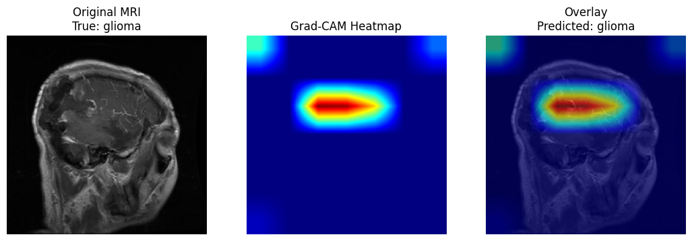
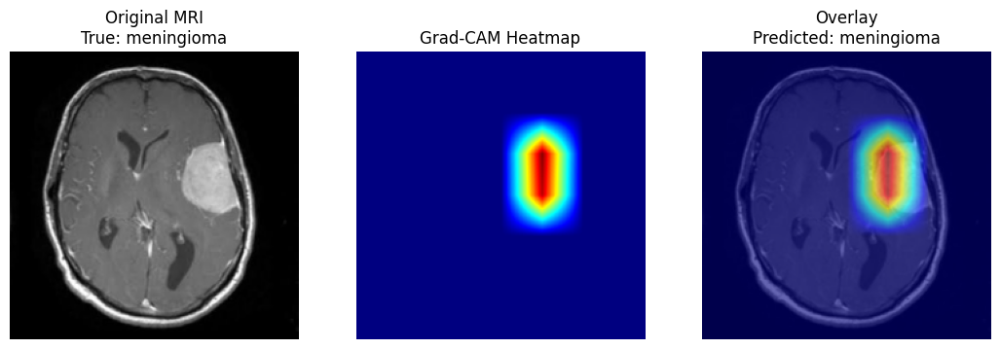
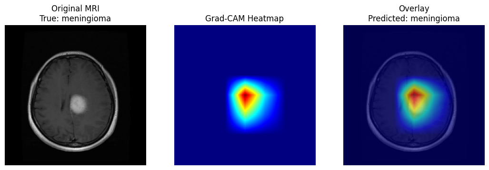
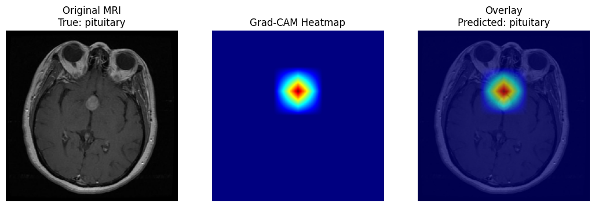

# Brain Tumor MRI Classification with Swin Transformer


Fine-tuning an ImageNet-pretrained **Swin Transformer (Swin-Tiny)** to classify brain MRI slices into four classes (**glioma**, **meningioma**, **pituitary tumor** and **no tumor**), with **Grad-CAM** visualizations that show which regions of the scan drove each prediction.

<p align="center">
  
</p>

## Highlights

- **99.24% accuracy** on 1,311 held-out test images, with F1 ≥ 0.98 for every class
- **Two-stage transfer learning**: train a new classifier head on the frozen backbone, then fine-tune the last two Swin stages at a lower learning rate
- **Explainability** with Grad-CAM on the last Swin Transformer block, localizing the tumor region behind each prediction

## Results

Evaluated on the dataset's separate `Testing` split, which is never used during training.

| Class | Precision | Recall | F1-score | Test images |
|---|---|---|---|---|
| Glioma | 0.984 | 0.997 | 0.990 | 300 |
| Meningioma | 0.993 | 0.974 | 0.984 | 306 |
| No tumor | 1.000 | 1.000 | 1.000 | 405 |
| Pituitary | 0.990 | 0.997 | 0.993 | 300 |
| **Overall accuracy** | | | **0.9924** | **1,311** |

<p align="center">
  
</p>

Only 10 of 1,311 test images are misclassified. Most errors are meningioma predicted as glioma (5) or as pituitary (3). These are the tumor types that look most alike on MRI.

## Grad-CAM explainability

Grad-CAM highlights the regions of the scan that most increased the score of the predicted class (red = strongest influence). Each example shows the original MRI with its true label, the heatmap, and the overlay with the model's prediction. The model attends to the tumor itself in every example.

**Glioma**
<p align="center"></p>
<p align="center"></p>

**Meningioma**
<p align="center"></p>
<p align="center"></p>

**Pituitary tumor**
<p align="center"></p>

The heatmaps are coarse because Swin-Tiny's last stage works on a 7×7 grid of tokens, so each cell covers a 32×32-pixel patch of the input.

## Method

### Dataset
[Brain Tumor MRI Dataset](https://www.kaggle.com/datasets/masoudnickparvar/brain-tumor-mri-dataset) (Kaggle), which combines the figshare, SARTAJ and Br35H collections.

| Split | Glioma | Meningioma | No tumor | Pituitary | Total |
|---|---|---|---|---|---|
| Training | 1,321 | 1,339 | 1,595 | 1,457 | 5,712 |
| Testing | 300 | 306 | 405 | 300 | 1,311 |

### Preprocessing and augmentation
- Resize to 224×224 and normalize each channel to [-1, 1]
- Training augmentation: random horizontal flip and random rotation (±10°)

### Model and training
| | |
|---|---|
| Backbone | `swin_tiny_patch4_window7_224` (28M params, ImageNet-pretrained, from `timm`) |
| Loss / optimizer | Cross-entropy / AdamW, batch size 16 |
| Stage 1 | Backbone frozen, train the 4-class head only, lr = 1e-3 |
| Stage 2 | Unfreeze Swin stages 3–4 (`layers.2`, `layers.3`) + head, lr = 1e-4, 10 epochs |
| Hardware | NVIDIA RTX 3050 Laptop GPU (~75 s per epoch) |

Freezing the backbone first lets the randomly initialized head converge without destroying the pretrained features. Unfreezing only the deeper stages then adapts the high-level representations to MRI data while the generic low-level filters stay as they are.

## Repository structure

```
├── torchswin.ipynb      # full pipeline: data, two-stage training, evaluation, Grad-CAM
├── gradcam.py           # standalone Grad-CAM script for any MRI image
├── images/              # Grad-CAM examples and confusion matrix
├── requirements.txt
└── LICENSE
```

## Getting started

```bash
git clone https://github.com/Rachit1903/swin-brain-tumor-classification.git
cd swin-brain-tumor-classification
pip install -r requirements.txt
```

1. Download the [dataset](https://www.kaggle.com/datasets/masoudnickparvar/brain-tumor-mri-dataset) and extract it so you have `data/Training/<class>/` and `data/Testing/<class>/`.
2. Run `torchswin.ipynb` top to bottom. It trains the model and saves the weights to `saved_models/swin_final.pth`.
3. Generate a Grad-CAM explanation for any image:

```bash
python gradcam.py --image data/Testing/glioma/Te-gl_0041.jpg --out result.png
```

> Trained weights (110 MB) aren't committed because they exceed GitHub's file size limit.

## Limitations

- The dataset has only 2D slices with image-level labels, without patient IDs, so the train/test split can't be guaranteed to be patient-independent. The public dataset is also known to contain near-duplicate images across splits, so the test accuracy may be optimistic for truly unseen patients.
- The model classifies tumor **type**. It doesn't localize, segment or grade tumors.
- **This is a research project, not a medical device.** It must not be used for clinical diagnosis.

## Roadmap

- [ ] Deduplicated, patient-aware evaluation
- [ ] ONNX export and batched inference benchmark
- [ ] REST API (FastAPI) and Docker image
- [ ] Interactive web demo

## License

[MIT](LICENSE)
